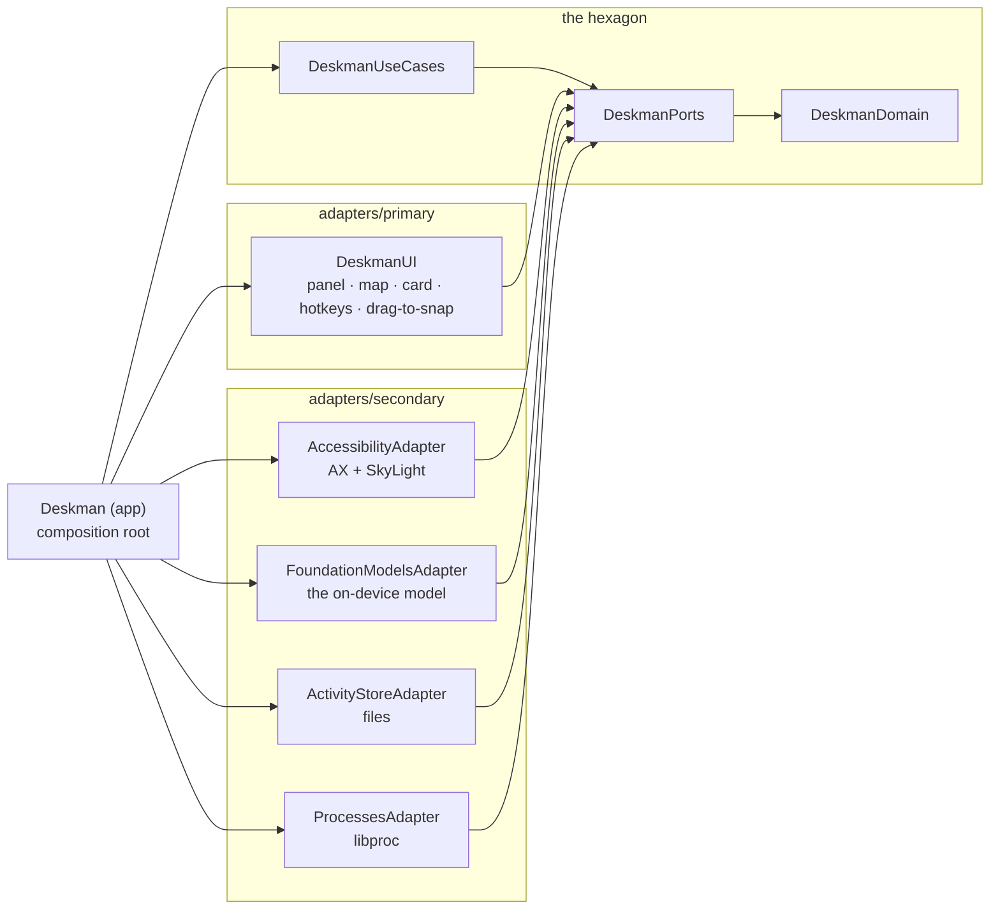

# Deskman

**Tell your Mac where to put its windows, in plain words.** Apple's on-device model
understands the request. Deskman moves the windows. Nothing leaves your Mac.


> "Safari and Notes side by side" · "put this window on the left third" ·
> "move this to my other screen" · "open Calendar on the right half" ·
> "organize my windows"

Deskman is a native macOS window manager. It has three parts that work together:

- **An assistant.** You type a request. The on-device model picks a tool. Deskman does the move.
- **A grid.** Five snap zones that Smart Arrange fills for you, and that you fill with a key or a drag.
- **A memory.** Deskman learns how you arrange your desktop, names each window by what it is for,
  and keeps the windows of one project together.

It replaces a Hammerspoon zone manager, and it obeys one promise above all others:
**on its own, Deskman never minimizes, closes or hides a window, and never moves the window you are working in.**

---

## Contents

- [Requirements](#requirements)
- [Install and start](#install-and-start)
- [Your grid](#your-grid)
- [Ask in words](#ask-in-words)
- [The menu bar](#the-menu-bar)
- [Keyboard and mouse](#keyboard-and-mouse)
- [What Deskman does on its own](#what-deskman-does-on-its-own)
- [What Deskman will never do](#what-deskman-will-never-do)
- [Privacy and your data](#privacy-and-your-data)
- [Why did it do that? The decision log](#why-did-it-do-that-the-decision-log)
- [Architecture](#architecture)
- [Develop](#develop)
- [Diagnostics](#diagnostics)
- [Design decisions (ADRs)](#design-decisions-adrs)

---

## Requirements

| Need | Why |
|---|---|
| macOS 26 or later, on Apple silicon | The `FoundationModels` framework exists only there. |
| **Apple Intelligence turned on** (System Settings → Apple Intelligence & Siri) | It is the model that reads your requests and names your windows. |
| Xcode 26 or later | For the Swift 6.2 toolchain. |
| The Accessibility permission | macOS lets an app move other apps' windows only with it. |

## Install and start

```bash
scripts/make-signing-identity.sh   # once: a local signing certificate
scripts/build-app.sh               # builds build/Deskman.app
open build/Deskman.app
```

1. Deskman opens a floating panel and puts an icon in the menu bar.
2. Click **Allow…** in the panel.
3. Turn on Deskman in System Settings → Privacy & Security → Accessibility.
4. Press <kbd>⌃</kbd><kbd>⌥</kbd><kbd>Space</kbd> from any app to show or hide the panel.
5. Type a request. Press <kbd>Return</kbd>.

The panel takes your typing without taking focus from your app, so "this window" means the
window you were using. Press <kbd>Esc</kbd> to hide the panel.

> [!IMPORTANT]
> Run `scripts/make-signing-identity.sh` before the first build. macOS remembers the Accessibility
> permission by the app's signature. The local certificate keeps that signature the same on every
> rebuild. Without it, the build is signed ad hoc, gets a new signature each time, and loses the permission.

> [!WARNING]
> Run Deskman **or** Hammerspoon's zone manager, not both. They both register
> <kbd>⌃</kbd><kbd>⌘</kbd><kbd>1</kbd>…<kbd>5</kbd>.

## Your grid

Every place Deskman puts a window is one of five snap zones, or a whole side column.

```
┌───────────┬───────────────────────┬───────────┐
│           │                       │           │
│  zone 1   │                       │  zone 4   │
│           │                       │           │
├───────────┤        zone 3         ├───────────┤
│           │   (your main window)  │           │
│  zone 2   │                       │  zone 5   │
│           │                       │           │
└───────────┴───────────────────────┴───────────┘
```

**Smart Arrange** fills the grid by these rules:

1. A window that is already in a zone **stays**. It is not moved.
2. Zone 3 goes to the window you named, else the browser you use most, else the window you use most.
3. A browser takes a whole column. Browsers are never stacked.
4. The other windows fill zones 1, 4, 2, 5, in order of how much you use them.
5. A window alone in a side column gets the column's full height (1+2 or 4+5).
6. Windows that you pinned, the one you work in, and meeting apps are kept. Their zones are blocked.
7. A window with no free zone **stays where it is**. It is never minimized. The message names it.
8. No place is smaller than 700 × 400 pt. Deskman reads every window back after the move. If an
   app refuses a size, Deskman remembers that app's minimum and plans again around it.

Every Smart Arrange can be undone from the card that appears after it.

### Deskman learns your grid

The drawing above is the **standard grid**. Deskman replaces it with your own, learned from how
*you* place windows, and then makes its zones equal.

1. Only your moves count: a drag, a resize, a snap key. A place Deskman chose teaches nothing.
2. Deskman learns the **shape**: how many columns, and how many zones each column stacks.
3. It makes the zones equal. Every column gets the same width. The zones in a column get the same height.
4. It needs 5 of your moves from the last 14 days. One window in one place counts once.
5. A shape too fine for the display loses its weakest edges, so no zone is under 700 × 400 pt.

For example, your 25% | 50% | 25% grid with stacked sides becomes three equal columns of 33%,
with the sides still split in two. The hotkeys, drag-to-snap, Smart Arrange and On Screen all use
the learned grid. A new grid moves no window: it applies at the next arrange or snap.

> [!NOTE]
> Two edges less than 10% apart count as one edge, and the one you used last wins. Without this
> rule, your old 25% edges and your new 33% edges would add up to five columns.

The first line of **Your grid** in What Deskman Knows says which grid is in use, and how many
of your moves count so far. Each change of grid is written to the decision log.

## Ask in words

Press <kbd>⌃</kbd><kbd>⌥</kbd><kbd>Space</kbd> and type. The model calls one of six tools:

| You ask for | The model calls |
|---|---|
| halves, quarters, thirds, two-thirds, maximize, center | `arrangeWindow` |
| "send this to my other screen" | `arrangeWindow` with `nextDisplay` |
| focus, minimize, restore, close, full screen, hide an app | `windowAction` |
| side by side, or a grid, of named apps | `tileWindows` |
| "tile all my windows", "organize my windows" (Smart Arrange) | `tileAllWindows` |
| start an app, and then place it | `openApp` |
| "what's open?" | `listWindows` |

You can name a window by its app, its title, or the name the model gave it
("the deskman session"). Windows on other desktops are listed, but only focus reaches them.

> [!NOTE]
> What *you* ask for is done, even a minimize or a close. The strict rules in
> [What Deskman will never do](#what-deskman-will-never-do) apply only to what Deskman does on its own.

## The menu bar

| Item | What it does |
|---|---|
| **Smart Arrange** <kbd>⌘S</kbd> | Fills [your grid](#your-grid) once. Undo from the card. |
| **Keep Arranged** | Runs Smart Arrange each time a window opens, closes, minimizes or comes back, or you change desktop. It waits until things are still for 1.5 s, so a burst of changes causes one arrange. It never moves the window you work in; that one gets its place when you move on. |
| **Desktop Map** <kbd>⌘M</kbd> | Opens the panel on its Map tab. See below. |
| **What Deskman Knows** <kbd>⌘K</kbd> | Opens the map directly on its What Deskman Knows tab. |
| **Open Decision Log** <kbd>⌘L</kbd> | Opens the [decision log](#why-did-it-do-that-the-decision-log) in Console. |
| **Open Deskman** | The panel, on its Ask tab. |
| **Drag to Snap** | Turns drag-to-snap on or off. The hotkeys still work when it is off. |
| **Apps Deskman Leaves Alone** | Apps whose windows Deskman never moves on its own. One item adds the front app. |
| **Bound Projects** | The projects you bound. A click unbinds one. Shows only when a project is bound. |
| **Learning** | The learn switch, and **Forget My Activity**. |

### The Desktop Map

The map draws your screens to scale. It has these parts:

- **Now** — your windows as they are, with the model's names, what runs in each terminal,
  🔗 for bound windows and 📌 for pinned ones. **Unpin All** is here.
- **Smart Arrange** — a preview of what Smart Arrange would do, with **Apply** and the Keep Arranged switch.
- **What Deskman Knows** — everything Deskman tracks, at the panel's standard size:
  - your habits, by zone (green = learned, red = still learning; click a red one to confirm it);
  - the windows you used most in the last 30 minutes, with minutes;
  - which grid is in use (learned or standard), and which zone each window holds;
  - what Keep Arranged is doing, in one sentence;
  - your bound projects.

A line that has nothing to show says "Nothing yet". The **On Screen** switch draws the zones over your real screen.

## Keyboard and mouse

| Keys | Action |
|---|---|
| <kbd>⌃</kbd><kbd>⌥</kbd><kbd>Space</kbd> | Show or hide the Deskman panel |
| <kbd>⌃</kbd><kbd>⌘</kbd><kbd>1</kbd> … <kbd>5</kbd> | Put the front window in snap zone 1…5 |
| <kbd>⌃</kbd><kbd>⌘</kbd><kbd>F</kbd> | Make the front window fill the screen |
| <kbd>⌃</kbd><kbd>⌥</kbd><kbd>F</kbd> | Add or remove the front app from Apps Deskman Leaves Alone |
| <kbd>⌃</kbd><kbd>⌥</kbd><kbd>D</kbd> | Turn drag-to-snap on or off |

**Drag to snap:** drag a window by its title bar and drop it on a zone. Hold <kbd>⌥</kbd> to drop it freely.

## What Deskman does on its own

- **Learns your arrangements.** Deskman records each arrangement that stays settled. A habit
  seen 3 times becomes a suggestion. Accept it 3 times, and Deskman applies it by itself.
- **Names your windows.** The on-device model names each window by what it is for
  ("Atlas Claude session"), from its title, its document and what runs in it.
- **Sees what runs in your terminals.** Program names and folders only, never arguments.
  A terminal with a busy job is never called idle, so Smart Arrange does not push it aside.
- **Binds a project's windows.** When the model gives one project to windows from two or more
  apps, Deskman offers to bind them. Bound windows stay side by side, come to the front together,
  move to another display together, and minimize together.
- **Puts a new browser window beside your terminal.**
- **Respects your hand.** A window you move or resize is pinned for 30 minutes. Smart Arrange works around it.
- **Pauses for meetings.** During a Zoom, Teams, Webex or FaceTime call, Keep Arranged changes nothing,
  on any desktop. What changed is arranged once the meeting ends.

## What Deskman will never do

One gateway (`WindowGateway`) stands between Deskman and every window. Each action carries its
origin: **you** (a click, a hotkey, a drag, Undo, an accepted suggestion, the assistant) or
**Deskman on its own** (Keep Arranged, a learned habit, a bound project, a browser placement).

What you ask for is done. On its own, Deskman:

- never minimizes, closes, hides, or fills the screen with a window;
- never moves the window you are working in;
- never moves, resizes or minimizes a meeting app's window;
- moves nothing at all while a meeting is on;
- never touches an app in Apps Deskman Leaves Alone;
- leaves alone a window it cannot see;
- never makes a window overlap another, or smaller than 700 × 400 pt.

Each refusal is written to the decision log with its reason.

## Privacy and your data

> [!TIP]
> Nothing leaves your Mac. The model runs on the device. Deskman makes no network calls.

| File | Holds |
|---|---|
| `~/Library/Application Support/Deskman/activity.jsonl` | Your settled arrangements, one per line (at most 5,000, at most 90 days old) |
| `~/Library/Application Support/Deskman/trust.json` | How often you accepted each habit |
| `~/Library/Application Support/Deskman/preferences.json` | Your switches, the apps left alone, bound and declined projects |
| `~/Library/Logs/Deskman/decisions.log` | The decision log, kept under 5 MB |

The records hold window titles, so the folder and its files are owner-only.
**Forget My Activity** erases the activity and trust files. It keeps your preferences.
Every window text passes through `EnglishOnly` before it goes into a prompt.

## Why did it do that? The decision log

Open it with <kbd>⌘L</kbd>. Each line has a time and one decision:

- what started an arrange (you, or Keep Arranged);
- the ranking, with minutes in front;
- each window that was kept in place, and why (pinned, worked in, a meeting app, an app left alone);
- which layout ran, and each move;
- every pin, with the frames before and after;
- every action the gateway did, refused or failed;
- each change of Keep Arranged's state.

## Architecture

Deskman is hexagonal, following the [hexa](https://git.local/gary/hexa) practices.
**Each layer is its own SwiftPM target**, so the compiler refuses an import that crosses a boundary.
The `dependencies:` lists in [`Package.swift`](Package.swift) *are* the architecture.



```
Sources/
  domain/      pure value types and rules, Foundation only:
               Geometry, Window, GridPlanner (your zones), GridLearner, ZoneGenerator, Zones, Layout,
               Learning, TargetMatcher, Terminals, Bindings, DesktopMap, Gateway (the policy),
               MeetingApps, Preferences, EnglishOnly, ScreenOutline
  ports/       the contracts; re-exports the domain value types
               driven:  WindowControl, Assistant, ActivityStore, PreferenceStore, DecisionLog,
                        TimeSource, WindowNamer, TerminalActivity
               driving: WindowCommands, DeskmanPort, ActivityPort, SnapPort, SettingsPort, BindingPort
  usecases/    what Deskman does, written against ports only:
               WindowService, DeskmanService, ActivityService, SmartArranger, SnapService,
               WindowGateway, BindingService, LearnedGrid, Settings, IntentLog, FocusTracker,
               WindowNames, TerminalWatch
  adapters/secondary/accessibility/      windows on every desktop; reads off the main thread
  adapters/secondary/foundation-models/  six tools, and the window namer — the only code that names a model
  adapters/secondary/activity-store/     activity, trust, preferences, the decision log
  adapters/secondary/processes/          what runs in terminals (names and folders, never arguments)
  adapters/primary/ui/                   panel, map, suggestion card, hotkeys, drag-to-snap
  app/                                   composition root — the only code that names adapters
  eval/                                  a second root: the real model against in-memory windows
```

Four rules hold the shape:

1. Adapters never import other adapters. No adapter target declares one.
2. Only `Sources/adapters/secondary/foundation-models/` may import `FoundationModels` or name a model.
3. Inside the hexagon, coordinates are top-left origin, y down. AppKit frames convert only
   through `CoordinateSpace` in the domain.
4. Tests use fakes of the ports ([`Tests/DeskmanTests/Fakes.swift`](Tests/DeskmanTests/Fakes.swift)),
   never copies of the code they test.

## Develop

```bash
scripts/gate.sh          # the architecture grade: run before every commit
scripts/build-app.sh     # build/Deskman.app
swift test               # the tests alone
swift run DeskmanEval    # does the real model pick the right tool?
```

**The gate** exits 0 only when all of these pass:

1. Every layer imports only what it may.
2. No code outside the model adapter names a model.
3. `swift build --explicit-target-dependency-import-check error` succeeds.
4. `swift test` passes, and at least one test ran. Zero tests is a failure, not a pass.

It must print `GATE PASS`.

## Diagnostics

A diagnose runs inside the app, so it has the app's Accessibility permission.
A binary started from a terminal has the terminal's permissions, and usually sees no windows.

```bash
scripts/diagnose.sh <check>
```

<details>
<summary><b>The checks</b></summary>

| Check | Shows |
|---|---|
| `menu` | The menu's items |
| `arrange` | What Smart Arrange would do now |
| `names` | The model's name for each window |
| `terminals` | Terminal jobs, and the window each belongs to |
| `bindings` | Projects, candidates and bound windows |
| `outline` | What the On Screen switch draws on each display |
| `speed` | How long the desktop read takes, and how long it holds the main thread |

A picture of the map:

```bash
open -W build/Deskman.app --args --diagnose-map /tmp/map.png "Smart Arrange"
```

A diagnose only looks. It writes nothing to the decision log and moves nothing.
Output that starts with `FAILED` means the copy could not see windows.

</details>

## Design decisions (ADRs)

Every decision, and its reason, is in [`docs/adrs`](docs/adrs/).

<details>
<summary><b>All ADRs, oldest first</b></summary>

| ADR | Decision |
|---|---|
| [2610101046](docs/adrs/ADR-2610101046-deskman-is-a-hexagonal-swift-app.md) | Deskman is a hexagonal Swift app, graded by its own target graph |
| [2610101415](docs/adrs/ADR-2610101415-deskman-learns-your-arrangements.md) | Deskman learns your arrangements |
| [2610101429](docs/adrs/ADR-2610101429-deskman-sees-every-desktop.md) | Deskman sees every desktop |
| [2610101501](docs/adrs/ADR-2610101501-smart-arrange-fills-hammerspoon-zones.md) | Smart Arrange fills Hammerspoon zones *(replaced by 2610101523)* |
| [2610101523](docs/adrs/ADR-2610101523-deskman-draws-its-own-zones.md) | Deskman draws its own zones |
| [2610101542](docs/adrs/ADR-2610101542-the-model-names-your-windows.md) | The model names your windows |
| [2610101549](docs/adrs/ADR-2610101549-deskman-sees-what-runs-in-your-terminals.md) | Deskman sees what runs in your terminals |
| [2610101607](docs/adrs/ADR-2610101607-tabs-by-activity.md) | Tabs by activity *(waits for the Automation permission)* |
| [2610120742](docs/adrs/ADR-2610120742-apps-deskman-leaves-alone.md) | Apps Deskman leaves alone |
| [2610120830](docs/adrs/ADR-2610120830-the-model-binds-a-projects-windows.md) | The model binds a project's windows |
| [2610121000](docs/adrs/ADR-2610121000-the-model-proposes-the-layout.md) | The model proposes the layout *(replaced by 2610121700)* |
| [2610121130](docs/adrs/ADR-2610121130-keep-arranged.md) | Keep Arranged |
| [2610121200](docs/adrs/ADR-2610121200-never-read-the-desktop-on-the-main-thread.md) | Never read the desktop on the main thread |
| [2610121330](docs/adrs/ADR-2610121330-the-model-gets-english-only.md) | The model gets English only |
| [2610121400](docs/adrs/ADR-2610121400-never-overlap-never-too-small.md) | Never overlap, never too small |
| [2610121500](docs/adrs/ADR-2610121500-meeting-apps-are-never-arranged.md) | Meeting apps are never arranged |
| [2610121600](docs/adrs/ADR-2610121600-show-what-deskman-knows.md) | Show what Deskman knows |
| [2610121630](docs/adrs/ADR-2610121630-a-decision-log.md) | A decision log |
| [2610121700](docs/adrs/ADR-2610121700-smart-arrange-fills-your-grid.md) | Smart Arrange fills your grid |
| [2610121800](docs/adrs/ADR-2610121800-every-action-through-one-gateway.md) | Every action goes through one gateway |
| [2610131157](docs/adrs/ADR-2610131157-deskman-learns-your-grid.md) | Deskman learns your grid from your moves, and makes its zones equal |

</details>
